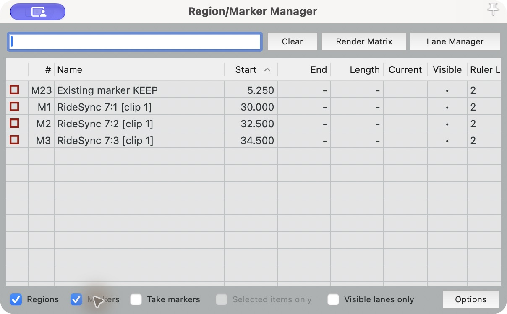

# Observed REAPER bookmark import — #63

**Pass — October 13, 2026, approximately 17:47 Europe/Amsterdam.** One actual
REAPER installation imported the three synthetic markers through the delivered
Lua adapter. This completes the remaining editor criterion of
[#63](https://github.com/llazzaro/RideSync/issues/63), alongside the existing
[software delivery evidence](../2026-10-13-bookmarks.md). It is an observed editor
result with synthetic offsets, not physical footage alignment or compatibility
with another editor.

## Installation and fixture identity

Host: macOS **27.0**, build **26A428**, Apple M1 / arm64. REAPER reported
**7.82/macOS-arm64**, rev **338578** (October 4, 2026) in its About window;
Info.plist version is `7.82.0_3385784u`. A temporary portable copy was extracted
from the [official universal evaluation download](https://dlcf.reaper.fm/7.x/reaper782_universal.dmg).
It ran with a separate `/tmp/ridesync-reaper-acceptance/reaper.ini`, an empty
project and no existing editing project or license key. Optional plugin scanning
and audio setup were declined. The evaluation notice was dismissed with
**Still Evaluating**. No REAPER executable or proprietary application files are
redistributed here.

| Installed artifact | SHA-256 |
| --- | --- |
| `reaper782_universal.dmg` | `27b1ff603d6e7941f158e1ea6e3e8009e4d8447857e06df00241900c42ff0491` |
| `REAPER.app/Contents/MacOS/REAPER` | `9631778ca492e61e298ec44b5d9136473285334143665e356b13e3bc25dc7b0c` |

The source candidate is `8317854f19a391da500edfc975694bf151bcb39f`; exporter behavior
is unchanged from the verified delivery in `7798ad6`. Inputs and generated adapter
come unchanged from the [pinned acceptance bundle](../2026-10-13-bookmark-editor/README.md).
Its [SHA256SUMS](../2026-10-13-bookmark-editor/SHA256SUMS) records source log,
alignment, synthetic clip identity, portable sidecar, report and adapter hashes.
Bundle verification regenerated byte-identical outputs in a fresh directory.
The text clip identity is deliberately not playable footage. Its declared
five-second duration and exact synthetic mapping suffice for this editor-only
marker check; no camera or media item was involved.

## Execution and observed values

REAPER's own `-help` documents loading Lua scripts through its command line.
The exact executed [observation script](run-observation.lua) uses the real
[ReaScript API](https://www.reaper.fm/sdk/reascript/reascripthelp.html#AddProjectMarker2),
not a mocked API. It creates one existing marker, saves a baseline, executes the
unchanged exporter-generated adapter with `dofile`, reads actual project markers
with `EnumProjectMarkers3`, saves the resulting project, then repeats the same
adapter and saves/readbacks again. `execution-status.txt` reports `COMPLETED`.
The script is tied to the host's temporary and repository paths; adapt those two
paths for reproduction and use only an empty disposable project.

```sh
REAPER.app/Contents/MacOS/REAPER -newinst -cfgfile /tmp/ridesync-reaper-acceptance/reaper.ini -new /tmp/ridesync-reaper-acceptance/run-observation.lua
```

| Marker | Independently expected seconds/name | Actual first import | Actual repeat import |
| --- | --- | --- | --- |
| Existing M23 | 5.25 / `Existing marker KEEP` | 5.250000000 / exact name | Same ID, position, name and color |
| Bookmark 7:1 | 30 / `RideSync 7:1 [clip 1]` | 30.000000000 / exact name | Unchanged |
| Bookmark 7:2 | 32.5 / `RideSync 7:2 [clip 1]` | 32.500000000 / exact name | Unchanged |
| Bookmark 7:3 | 34.5 / `RideSync 7:3 [clip 1]` | 34.500000000 / exact name | Unchanged |

The independent arithmetic is `(session_ms - 10000) / 1000 + 30`, for session
milliseconds 10000, 12500 and 14500. Actual marker counts were **1 baseline,
4 after first import, 4 after repeat**. No duplicate marker or region appeared.
The baseline existing marker retained ID 23, color 0 and its saved-project GUID.
Both post-import TSV files and both post-import project files are byte-identical.
Saved projects contain exactly the observed marker positions/names.

The native UI was also inspected using **View → Time unit for ruler → Seconds**,
then **View → Region/Marker Manager**, enabling its **Markers** checkbox. It
visibly displayed M23 at 5.250, M1 at 30.000, M2 at 32.500 and M3 at 34.500,
with exact names. The following screenshot is from that real application window:



## Preserved observations and verification

- [Baseline API readback](baseline.tsv) and [saved project](baseline.rpp).
- [First import readback](first-import.tsv) and [saved project](first-import.rpp).
- [Repeat import readback](repeat-import.tsv) and [saved project](repeat-import.rpp).
- [Execution status](execution-status.txt), [executed script](run-observation.lua)
  and [artifact hashes](SHA256SUMS).

An independent reviewer inspected the screenshot, TSV values, project marker
lines, existing-marker identity and unchanged repeated-import artifacts. The
pinned bundle hashes and fresh exporter regeneration passed. Documentation links,
whitespace, Lua syntax and the mandatory repository checks accompany this
evidence-only delivery. Unchanged firmware/build evidence is reused under
[acceptance policy](../../acceptance_policy.md): the bookmark software candidate
[CI](https://github.com/llazzaro/RideSync/actions/runs/38393487286) and latest
handoff [CI](https://github.com/llazzaro/RideSync/actions/runs/38422461688) passed.

Executable regressions in `test/test_reaper_adapter.py` export fresh fixtures
and execute the generated adapter in Lua 5.4 against test-only marker storage.
They check existing marker/region preservation, exact positions/names, repeat
import, equal-time IDs and collisions with regions/unrelated marker names.
CI installs the pinned Ubuntu Lua package and runs these through normal Python
discovery; Lua is a test dependency, not an exporter runtime requirement.
These synthetic API tests complement the actual application observations above.
Local invocation: `python3.11 -m unittest discover -s test -p test_reaper_adapter.py -v`.

This qualifies one documented REAPER API import on this version and OS. It does
not establish real clip offsets, frame accuracy, camera HiLights, installed
button behavior, other editors or ride readiness. Hardware acceptance stays
with #22/#30/#31/#46. The earlier unavailable-editor record is historical and is
superseded by this observation.
